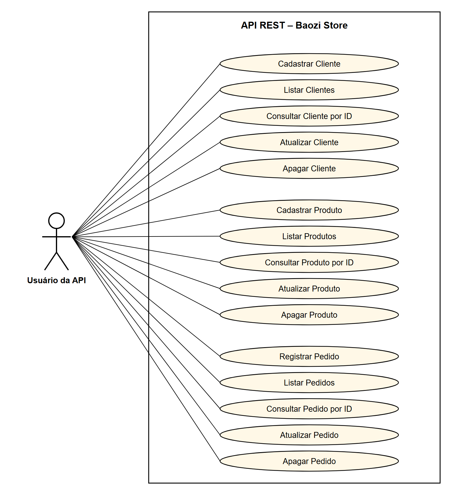

# 🥟 Baozi Store API

API REST para controle de **clientes**, **produtos** e **pedidos** da Baozi Store, uma pequena loja que vende pãozinho chinês (baozi).

Atividade Prática da disciplina **Desenvolvimento Web Back-End**, do Centro Universitário Internacional UNINTER.

| | |
|---|---|
| **Aluno** | ROGER VARELA DOS SANTOS |
| **RU** | 4994659 |
| **Curso** | CST Análise e Desenvolvimento de Sistemas - Distância (2701) |

---

## Tecnologias

- Java 21
- Spring Boot 4 (Spring Web MVC)
- Spring Data JPA / Hibernate
- Bean Validation (validação dos dados de entrada)
- Banco relacional **H2** salvo em arquivo (`./data/baozidb`), então os dados continuam depois que a API é reiniciada. Também há um perfil opcional para **MySQL**
- Maven (via Maven Wrapper, sem precisar instalar)
- Postman (testes)

## Arquitetura (padrão MVC do Spring)

```
src/main/java/br/com/uninter/baozistore
├── model/        -> entidades JPA (Cliente, Produto, Pedido)
├── repository/   -> interfaces Spring Data JPA (acesso ao banco)
├── service/      -> regras de negócio
├── controller/   -> endpoints REST (JSON)
├── dto/          -> objeto de entrada do pedido (PedidoRequest)
└── exception/    -> tratamento global de erros em JSON
```

## Entidades

### Cliente (`tb_cliente`)
| Campo | Tipo | Regra |
|---|---|---|
| id | Long | gerado automaticamente |
| nome | String | obrigatório, máx. 100 caracteres |
| clienteDesde | LocalDate | opcional; se não for enviado, vira a data de hoje; não pode ser futura |

### Produto (`tb_produto`)
| Campo | Tipo | Regra |
|---|---|---|
| id | Long | gerado automaticamente |
| nome | String | obrigatório, máx. 100 caracteres |
| preco | BigDecimal | obrigatório, maior que zero, 2 casas decimais |
| estoque | Boolean | obrigatório (`true` = disponível, `false` = em falta) |

### Pedido (`tb_pedido`)
| Campo | Tipo | Regra |
|---|---|---|
| id | Long | gerado automaticamente |
| cliente (clienteId) | Cliente (`@ManyToOne`) | obrigatório, precisa existir |
| produto (produtoId) | Produto (`@ManyToOne`) | obrigatório, precisa existir e estar em estoque |
| quantidade | Integer | obrigatório, mínimo 1 |
| valorTotal | BigDecimal | calculado pela API: `preco × quantidade` |
| dataPedido | LocalDateTime | preenchida automaticamente |

Relacionamentos: **um Cliente faz 0..N Pedidos** e **um Produto é vendido em 0..N Pedidos**.

## Endpoints

Base: `http://localhost:8080/api`

| Método | Rota | Descrição | Sucesso |
|---|---|---|---|
| POST | `/clientes` | Cadastrar cliente | 201 |
| GET | `/clientes` | Listar todos os clientes | 200 |
| GET | `/clientes/{id}` | Consultar cliente por ID | 200 |
| PUT | `/clientes/{id}` | Atualizar cliente | 200 |
| DELETE | `/clientes/{id}` | Apagar cliente | 204 |
| POST | `/produtos` | Cadastrar produto | 201 |
| GET | `/produtos` | Listar todos os produtos | 200 |
| GET | `/produtos/{id}` | Consultar produto por ID | 200 |
| PUT | `/produtos/{id}` | Atualizar produto | 200 |
| DELETE | `/produtos/{id}` | Apagar produto | 204 |
| POST | `/pedidos` | Registrar pedido | 201 |
| GET | `/pedidos` | Listar todos os pedidos | 200 |
| GET | `/pedidos/{id}` | Consultar pedido por ID | 200 |
| PUT | `/pedidos/{id}` | Atualizar pedido | 200 |
| DELETE | `/pedidos/{id}` | Apagar pedido | 204 |

### Exemplos de JSON

**POST /api/clientes**
```json
{ "nome": "Roger4994659", "clienteDesde": "2026-09-27" }
```

**POST /api/produtos**
```json
{ "nome": "Baozi de Porco Tradicional", "preco": 7.50, "estoque": true }
```

**POST /api/pedidos**
```json
{ "clienteId": 1, "produtoId": 1, "quantidade": 6 }
```

Resposta:
```json
{
  "id": 1,
  "cliente": { "id": 1, "nome": "Roger4994659", "clienteDesde": "2026-09-27" },
  "produto": { "id": 1, "nome": "Baozi de Porco Tradicional", "preco": 7.50, "estoque": true },
  "quantidade": 6,
  "valorTotal": 45.00,
  "dataPedido": "2026-09-27T12:52:58"
}
```

### Respostas de erro

Todos os erros voltam no mesmo formato JSON:

```json
{
  "timestamp": "2026-09-27T12:52:17",
  "status": 404,
  "erro": "Not Found",
  "mensagem": "Cliente com id 99 nao encontrado",
  "caminho": "/api/clientes/99",
  "detalhes": []
}
```

| Situação | Status |
|---|---|
| Campo obrigatório vazio ou inválido | 400 |
| Pedido de produto sem estoque | 400 |
| ID inexistente | 404 |
| Apagar cliente/produto que tem pedidos | 409 |

## Como executar

Pré-requisito: **JDK 21** instalado (ex.: [Eclipse Temurin 21](https://adoptium.net/temurin/releases/?version=21)).

**Windows:** dê dois cliques em `iniciar-api.cmd`, ou rode:

```bash
mvnw.cmd spring-boot:run
```

**Linux / macOS:**

```bash
./mvnw spring-boot:run
```

A API sobe em `http://localhost:8080`.

### Usando MySQL (opcional)

O projeto também tem o driver do MySQL e um perfil `mysql` pronto (`application-mysql.properties`). Com o MySQL rodando na porta 3306, abra `iniciar-api-mysql.cmd`, troque `MYSQL_PASSWORD` pela senha do seu usuário `root` e rode o script. O banco `baozi_store` e as tabelas são criados automaticamente.

- **Console do H2:** `http://localhost:8080/h2-console`
  - JDBC URL: `jdbc:h2:file:./data/baozidb` · Usuário: `sa` · Senha: *(vazia)*
- **Testes automatizados:** `mvnw.cmd test`

## Testes no Postman

Importe o arquivo [`postman/Baozi-Store-API.postman_collection.json`](postman/Baozi-Store-API.postman_collection.json) no Postman (**Import → Upload files**). A coleção já tem as 15 requisições, organizadas em pastas.

## Diagrama de Caso de Uso


